

  <picture><source media="(prefers-color-scheme: dark)" srcset="./assets/header-dark.svg">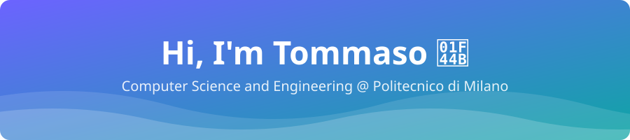</picture>

  

  Computer Science Engineering student at the <strong>Politecnico di Milano</strong>, completing my BSc while beginning my MSc. 
  I enjoy building useful software, from backend systems to desktop and mobile apps.

  
  
  

<picture><source media="(prefers-color-scheme: dark)" srcset="./assets/snake-0-dark.svg"></picture>

## About me

  <picture><source media="(prefers-color-scheme: dark)" srcset="./assets/about-dark.svg"></picture>

<picture><source media="(prefers-color-scheme: dark)" srcset="./assets/snake-1-dark.svg"></picture>

<!-- NOW:START -->

  <a href="https://github.com/tommipisca/Pinboard"><picture><source media="(prefers-color-scheme: dark)" srcset="./assets/now-dark.svg"></picture></a>

<!-- NOW:END -->

<picture><source media="(prefers-color-scheme: dark)" srcset="./assets/snake-2-dark.svg"></picture>

## Projects

<!-- PROJECTS:START -->

  <a href="https://github.com/tommipisca/Pinboard"><picture><source media="(prefers-color-scheme: dark)" srcset="./assets/card-pinboard-dark.svg">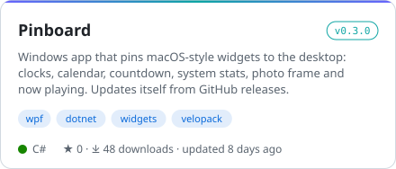</picture></a>
  <a href="https://github.com/tommipisca/ExamsTrack"><picture><source media="(prefers-color-scheme: dark)" srcset="./assets/card-examstrack-dark.svg">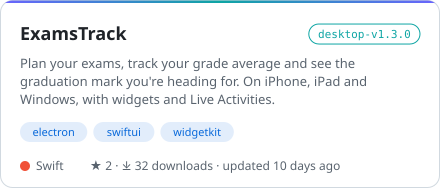</picture></a>
  <a href="https://github.com/tommipisca/Expenses"><picture><source media="(prefers-color-scheme: dark)" srcset="./assets/card-expenses-dark.svg">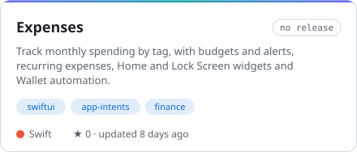</picture></a>
  <a href="https://github.com/tommipisca/DashPrise"><picture><source media="(prefers-color-scheme: dark)" srcset="./assets/card-dashprise-dark.svg">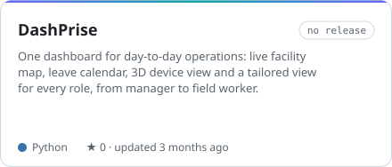</picture></a>
  <a href="https://github.com/tommipisca/PaperSieve"><picture><source media="(prefers-color-scheme: dark)" srcset="./assets/card-papersieve-dark.svg">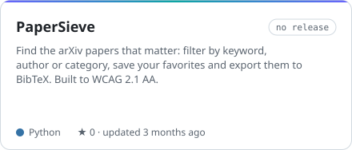</picture></a>
  <a href="https://github.com/tommipisca/ing-sw-2026-piscaglia-polise-pellizzari-polinelli"><picture><source media="(prefers-color-scheme: dark)" srcset="./assets/card-ing-sw-2026-piscaglia-polise-pellizzari-polinelli-dark.svg">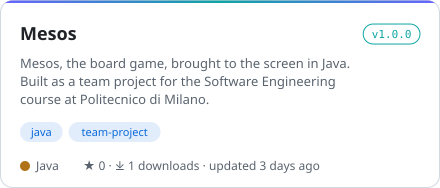</picture></a>

<!-- PROJECTS:END -->

<picture><source media="(prefers-color-scheme: dark)" srcset="./assets/snake-3-dark.svg"></picture>

## GitHub stats

  <picture><source media="(prefers-color-scheme: dark)" srcset="./assets/languages-dark.svg"></picture>
  <picture><source media="(prefers-color-scheme: dark)" srcset="./assets/glance-dark.svg"></picture>

<picture><source media="(prefers-color-scheme: dark)" srcset="./assets/snake-4-dark.svg"></picture>

## Tech stack

  

<picture><source media="(prefers-color-scheme: dark)" srcset="./assets/snake-5-dark.svg"></picture>

## Contact

  

  
  
  

  <picture><source media="(prefers-color-scheme: dark)" srcset="./assets/footer-dark.svg">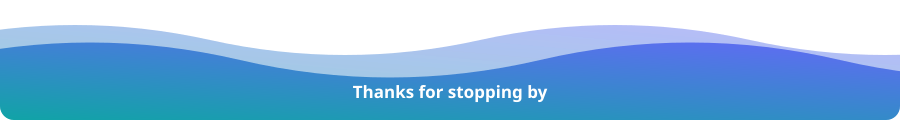</picture>

<!-- UPDATED:START -->

Updated automatically every night · last run Nov 22, 2026

<!-- UPDATED:END -->
